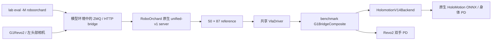

# HoloMotion v1.4 + Revo2 接入

当前代码提供与 Sonic 同级的 `HolomotionV14Backend`，CLI 名称为 `holomotion`；机器人名称为 `G1Revo2`。这是评测接入实现：CPU 接口、仿真装配以及真实 VLA + HoloMotion ONNX 在 EmptyEnv 的连续调用已检查；已执行三个操纵任务各一次，均未成功，尚未通过行为验收。暂不提供该后端的遥操作采集、训练或真机支持。

## 结构与数据契约



- 模型输入为 RGB 左头部图像 `640×360`、身体 29 + 双手 22 共 51 维实测关节、物理 pelvis 的世界坐标 xyz + wxyz 四元数（挂载移动底座后不能使用位于地面的 freejoint 平移）、任务文本与 episode/step history。162D 训练输入的构造仍归原生模型 processor。
- 原生 server 完成 token → `[30,151]` → `[50,87]`。87 维按 body q29、dq29、root xyz3、quat wxyz4、left11、right11 排列。
- 控制 50 Hz，每 16 tick 重规划（3.125 Hz）。每个 tick 交付当前帧加未来 10 帧；新 chunk 替换参考队列，身体和双手均取同一当前帧。禁止动作 EMA、异步跳帧和 Dex3 手部 snapping。
- controller 使用仿真时钟，episode reset 清空原生状态、缓存和参考索引；模型侧使用新的 episode identity 重置 history。
- Revo2 来自 SIMPLE 的 `g1_rot0_teleop_revo2_v3.xml`。保留 51 个执行器、10 个耦合约束、122 个传感器、3.2 kg backpack、手部标定和相机；显式零惯性声明兼容 MuJoCo 3.3.1。机器人与普通 G1 分别注册。

## 本地配置与运行入口

先保留现有 LocoManiLab benchmark 环境，并将修改后的 `external/g1_backend`、`external/humanoid_benchmark` 及其 `robosuite_src` 安装/关联到该环境。控制器运行环境需增加 `g1_backend[holomotion]` 的 OmegaConf 依赖；模型仍在 RoboOrchard 自己的已准备环境中启动，主 CLI 不导入模型。

在自己的 workspace 配置中合并以下字段；不要覆盖已有配置。占位路径须替换为实际路径：

```yaml
repos:
  roboorchard: /path/to/robo_orchard_lab
paths:
  roboorchard_job: /path/to/saved-training-job
  roboorchard_runtime: runs/roboorchard/runtime
```

使用与 unified-v1 匹配的完整 saved job（包括原生服务所需的 source、effective config、tokenizer 和 checkpoint）。默认选择原生服务认定的最新完整 checkpoint；不能用一个孤立权重文件替代 saved job。模型服务以 `uv run --no-sync` 启动，需预先准备好其环境，包括兼容 bridge 使用的 `numpy`、`pyzmq` 和 `msgpack-numpy`。当前插件仅支持 eval。

HoloMotion 默认 manifest 位于 `external/g1_backend/checkpoints/holomotion/v14/policy.yaml`。权重不随代码提供；将对应模型目录放到该 manifest 的 `models_dir` 指向位置，或另写本地 manifest 并使用 `--policy-config`：

```text
models/
  velocity_tracking_model/
    config.yaml
    exported/<one-model>.onnx
  motion_tracking_model/
    config.yaml
    exported/<one-model>.onnx
```

默认 manifest 保存 SIMPLE backpack bundle 的已知 SHA256；runtime 加载前校验。自定义 manifest 不能被当成已经验证兼容的新模型。

```bash
lab eval --model roboorchard --sim --backend holomotion \
  --robot G1Revo2 --run-dir /path/to/saved-training-job \
  --policy-config /path/to/holomotion/policy.yaml \
  --inference-backend onnx-cpu --inference-rate 3.125 \
  --env EmptyEnv --episodes 1 --max-steps 32 --prompt "stand still"
```

上例是环境接通检查入口，`EmptyEnv` 没有操纵任务成功指标。实际评测需指定 benchmark 任务及其场景资源。CLI 默认 robot 会在选 holomotion 时解析为 G1Revo2；显式使用其他本体会拒绝启动。`onnx-cpu` 仅指身体控制器，VLA 模型仍可能需要 GPU。

## 验证边界与后续验收

已进行原生参考队列时序测试、模型 HTTP payload/reset 与 saved-source 解包测试、机器人 XML/插件装配和移动底座物理 pelvis 坐标回归检查。

真实 checkpoint 和 ONNX 已在 EmptyEnv 连续运行 320 个控制步、20 次 VLA 推理，输出保持 50×87 契约；这只证明运行链路接通。当前空场景预测的首帧根姿态接近倒置，rollout 摔倒，不能声称 VLA 行为验收通过。固定直立参考配合相同机器人和真实 ONNX 的 320 步对照保持站立（末端 pelvis 高度约 0.767 m）。需要进一步区分场景分布、模型输出和适配语义。

本地 bundle 的 motion config 与默认 manifest 的来源 hash 不同；其附带说明记录了公开 v1.4.1 配置替换。本次使用单独的本地 manifest 明确锁定实际 SHA256，未修改默认契约。这一配置差异仍须在正式验收时处理。

离线资产包已校验并导入 22,618 个外部文件，解除正式任务初始化阻塞。使用同一 checkpoint 在 scene13 运行抓茄子（455 步）、杯子放水槽（516 步）、马克杯放盘子（519 步），各 1 个 episode，95 次推理，全部无运行错误，但三次均未完成任务。前两次保持站立并偏离目标位置，第三次摔倒。记录中存在倒置的模型根姿态参考；尚未完成同输入的 SIMPLE 对照，不能将失败归因于单一组件。单次运行结果不构成可靠的任务成功率估计。

新机器可按 [资产下载说明](hf_resources.md) 使用 `scripts/hf/download.py assets --task …` 下载任务文件；无需为此下载训练数据或其他 VLA 权重。下载工具核对每个文件的 SHA256。

已使用本地 Docker 的 Python 3.10、Torch 2.8.0+cu128、Transformers 4.57.1、DeepSpeed 0.17.1、FlashAttention 2.8.1 加载 saved job；模型和仿真分别限制为 4 CPU，ONNX 使用 CPU。Docker 验证脚本属于本地环境配置，当前主 CLI 不会自动创建 Docker 容器。

真实模型验收需要先准备对应 VLA saved job、HoloMotion bundle 和任务场景：先比对 SIMPLE 与本平台对同一低状态/参考的 controller 输出，再检查头部相机渲染方向、关节状态顺序、reset 后第一个预测与连续多 chunk，最后执行相同任务/种子的 rollout。平台动力学、接触与控制子步不同，不能由接口测试推断成功率一致。

实现横跨主仓库和两个子模块。内部交付将两个子模块提交保存在同一内部仓库的独立依赖分支，主仓库通过 `.gitmodules` 和 gitlink 锁定它们；上游来源仍保留在提交历史中。克隆后仅需初始化这两个依赖：

```bash
git submodule update --init external/g1_backend external/humanoid_benchmark
```

AIDI 提交入口和离线 worker 配置见 [AIDI 接入说明](aidi_roboorchard_eval.md)。来源与第三方条款分别记录在 controller 的 `SOURCE.md` / `SOURCE.json` 和机器人资源的同名文件。
